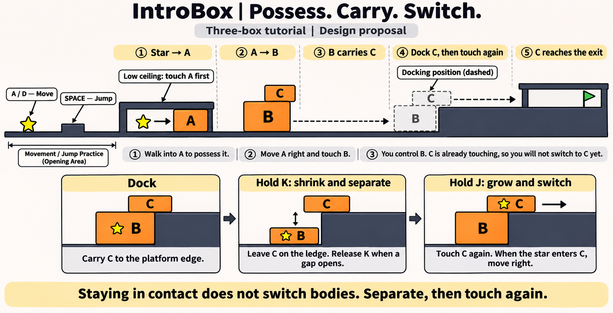

# IntroBox: possess, carry, switch

Branch: `gold-polish-kindergarten`. Source-only change, not a deployed build.

## Scene and teaching sequence

`Assets/Scenes/IntroBox.unity` retains the opening Star movement and Space-jump lesson, then introduces Star → A → B → C in separate steps. The entry roof blocks a Star jump over A. B carries the already-touching C to an ordinary fixed ledge. Shrinking B leaves C supported; growing B after separation transfers control to C. C shrinks through the final low passage, opens the flag gate and continues to IntroBubble.

The scene has a dedicated `IntroBox Carry Layout` root. The previous layout remains inactive for reference. A, B and C use the same ordinary resize limits (0.5–2 times their authored base scale), not special per-box restrictions. The top-center form banner is disabled. The camera follows the current lesson and all new instructional text is near the relevant body or terrain.

### Visual controls and brief contextual hints

The original warm gray camera background, charcoal terrain, orange boxes and yellow Star are retained. No A/B/C letters appear on the bodies. The existing form-controls HUD remains intact. World-space `BubbleMovementHint` guides show the original A/D keycaps and Space keycap with a jump arc. `BoxGrowHint` supplies dashed size outlines, inward/outward arrows, J/K keycaps and mouse-button icons at the dock, reconnect step and low passage. Mobile mode uses the existing touch control graphics.

The first-touch sign stays in the entry wall. Later brief local prompts have no backplate; a slash below indicates a line break:

- First contact: a permanent gold/white sign inside the black entry roof reads “Touch it. Become it!” and “Find a new body. Make it yours.” A Star → Star-inside-box diagram clarifies eligible bodies.
- First box: “Touch the next box.”
- Starting to carry: “Can you figure out how to become / the box above you?”
- Approaching the ledge: “A spot for your passenger!” plus the dotted route and landing outline.
- Dock: “Leave it here. / Move apart, then touch again.”
- Separated: “Touch it again to switch. / Only a new touch counts.”
- If growth is blocked: “Move a little left.”
- Recovery: “Carry it to the ledge.”

The opening runway extends four units farther left, with the Star and A/D guide moved left together. A/D appears first; Space takes over near the unchanged jump step.

Movement, jumping, growing and shrinking are demonstrated visually, with no explanatory paragraphs or plain-text keyboard instructions. External pause hides contextual hints and lesson control guides. The carry reveal now eases the camera right with uninterrupted input and physics, then presents the question for a few seconds. A gold dotted path and downward arrow lead to a fixed passenger-sized outline at the ledge. There are no forced reading pauses or countdown bars. Dock shrink/grow diagrams and recontact text remain at the platform; walking away hides the local prompts without moving them.

The existing gate-open arrow replaces the extra EXIT label.

## Implementation boundaries

- `IntroBoxCarryLesson` observes the existing physics and ownership state. While unacquired C is physically supported by controlled B, it matches B's horizontal velocity. This avoids relying on friction alone when starting, stopping or reversing. It does not parent C or carry it through a gap.
- Possession still goes through `PlayerPossessionController`'s existing target locks and recontact checks. There is no added possession cooldown.
- Premature shrinking/possession or dropping C from the ledge resets just the B+C lesson. Once C is docked, carrier/passenger horizontal distance is no longer a failure condition: walking away and returning is valid progress. `TryRestoreLessonBody` is guarded to IntroBox and clears queued input/contacts before re-locking the restored stack. It does not change ordinary transfers elsewhere.
- The exit and return-body references now target C. A return from IntroBubble preserves the completed state rather than triggering cargo recovery.
- `IntroBoxCarrySetup` is an explicit scene-authoring utility; it never runs automatically when opening Unity. It refuses to rebuild an already-authored carry scene.

## Verification

Unity 6000.3.22f1 compiled and exercised a disposable project copy with analytics disabled and separate verification preferences. Real keyboard input and physics were used for:

- Star movement, the initial jump, and repeated jump attempts at the mandatory A entry.
- A → B transfer without immediately possessing the touching C.
- Forward travel and a short reversal with C supported on B.
- Dock, shrink, stable separation, regrow and transfer to C without ping-pong.
- Shrinking C through the passage, flag activation, and forward loading of IntroBubble.
- Return from IntroBubble to C at the open exit, followed by fresh-scene reset to Star.
- Premature shrink recovery back to the B+C stack without a reset loop.
- Pause hiding the local hint and touch-mode instruction vocabulary.

All route assertions passed. Runtime screenshots were inspected for hint placement and readability. These checks do not replace a first-time-player readability test or real-device touch testing. The disposable Editor also logged an unrelated QuickSearch startup index exception; gameplay checks continued and completed successfully.

The live visual-polish route also passed assertions that the dock shrink, reconnect grow and passage shrink graphics are active. Captures were inspected for keycaps, arrows, outlines, brief text and restored colors.

The latest live Editor regression additionally shrank the carrier at the dock, walked left out of the hint area, and returned to regrow and possess the parked passenger. It checked that the scene and progress did not reset, the passenger stayed on the platform, both resize guides and dock text kept their world positions, and no forced pause interrupted the camera reveal. The complete exit/return/reload/recovery route passed afterward.

The visual polish was applied directly to the open live Unity scene using **Tools > IntroBox > Polish Current Scene Visuals**. **Tools > IntroBox > Verify Current Scene in Play Mode** exercises the current project and returns to Edit Mode without closing Unity. It restores the input/background settings used for the check. Runtime captures are written to `/private/tmp/introbox-captures`. The guarded batch entry point remains available for separate verification environments.

## English map

The concept image was translated with the built-in image-generation editor, using the previously approved Chinese three-box map as the reference. The requested edit preserved the geometry and A/B/C identities, translated all annotations, and added the opening A/D and Space practice area before the low entry tunnel. It is a concept image, not a Unity screenshot.
