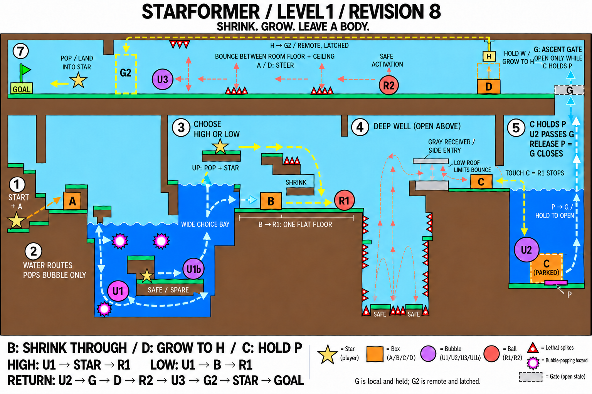

# Level 1 Progress

Last updated: 2026-10-18.

Scene: [Level01.unity](../Assets/Scenes/Level01.unity). Level baseline merged into `main` through PR #2, merge commit `d8a0c70`. Core prefabs merged through PR #3. Hazard prefab follow-up: `core-form-prefabs`, implementation baseline `af9e0aa`. Design reference: Level 1 Revision 08.

**Historical Level 1 polish baseline: the Level 1 polish pass is implemented through `5f134cd`. Any controlled form can finish after G2 opens, the final U3 bubble/canopy have been removed, purple hazards kill controlled boxes and display black X markers, the three upper ceiling spikes now sit on the floor, and death feedback is restored. The developer reported successful tests of these changes, upper ball traversal and completion. This polish pass is now merged into `main` through PR #8 (`c63a17c`). Navigation is merged into `main` through PR #9 (`9fc0f95`), including the Level01 menu entry and return button. The rebuilt localhost version and the GitHub Pages release passed developer-reported playtests. Teammate testing and broader route/browser coverage remain follow-up checks.**

**October 12 release follow-up:** Level01 is retained in All-Level V1 alongside Tutorial and the newly integrated Level02. An Input System exception occurred during editor regression testing. After the reload/restart diagnostic steps, the developer reported successful retesting and a successful localhost test of the new build. This update records release and integration progress, with no new Level01 layout or gameplay changes.

**Last recorded Web publication (predates the intros):** All-Level V2 (`8c48475`) replaces V1 with a build from `d161538`, including the Level02 fan-hint fix. Level01 remains included, with no new Level01 gameplay edits in this documentation pass. The same build is frozen at the [Alpha Progress Check URL](https://xtraluck21.github.io/StarFormer/alpha-progress-check/) by `5a7f043`, and the developer confirmed that URL works. The [root URL](https://xtraluck21.github.io/StarFormer/) tracks the latest tested release. Preserve the submission folder when publishing future versions. See [publish_instructions.md](publish_instructions.md) for the deployment procedure.

For controls and tuning, see [GameplaySpec.md](GameplaySpec.md). For script responsibilities, see [ScriptGuide.md](ScriptGuide.md).

**October 14 source update:** [PR #10](https://github.com/XtraLuck21/StarFormer/pull/10), merge `69f3902`, connects Mainmenu → IntroBox → IntroBubble → Level01 → Level02. Level01 still accepts any controlled form after G2 opens, but now clears checkpoints and loads Level02 instead of pausing at a completion screen. Shared bubbles wait until first possession and use **E** to pop. The developer confirmed the full flow in Unity Play Mode; this update has not been published as a new WebGL build. See [intro-levels.md](intro-levels.md).

**October 17 source update (merged):** [PR #11](https://github.com/XtraLuck21/StarFormer/pull/11), merge `989d2d1`, adds a generated `Level up!` / `Entering Level 2...` overlay to LevelGoal. Completion still requires any living controlled form and an open G2; gameplay pauses for a default 1.5 seconds before automatic progression. The developer reported that the completion transitions work. This does not claim a new Level01 layout review, teammate-branch merge or browser build.

**October 18 Level 1 handoff (awaiting PR to main):** `level-1` contains the teammate polish/checkpoint update (`62bb009`), right-pool bubble regeneration (`ea04ed9`), integration of main (`7ade8ee`), and the tested handoff/prefab fixes (`1f07b35`). The developer reports Level 1 testing passed, including the box no longer pinning the newly possessed bubble and normal BouncyBall behavior. Instruction clarity can still improve but is explicitly deferred as low priority. No new WebGL export or browser validation is recorded for this pass.

Current additions:

- Possessing a bouncing ball records its authored spawn position for automatic death recovery. Level01 opts in through `Enable Bouncy Ball Checkpoints`; other scenes retain their existing recovery behavior. R starts Level01 from the beginning. Death reload resets the scene's puzzle objects and restores control to the recorded ball; it is not a full puzzle-state save.
- The lower ball displays an A/D steering prompt on first possession. Both balls use the shared halo visual. The prefab now stores `BodyForm.BouncyBall = 7`; its generator writes the enum value explicitly. Level01's two existing instances already had the correct override.
- `Bubble_U2` regenerates a fresh dormant bubble at its authored position after E or a hazard pop. U1/U1b do not gain this regeneration component.
- Box-to-Bubble transfer temporarily ignores only the previous box/new bubble collision pair. After clearance for consecutive physics frames, normal collisions resume. Terrain, other bodies, and the pressure-plate rules remain active; this is not permanent immunity to boxes.
- U1/U1b/U2 holding canopies are removed, matching dormant-until-possessed bubbles. The scene uses gray/dark terrain colors, pink-red X-marked water hazards, and revised lower-right camera framing.

## 1. Current route and progress

*Historical Revision 08 design reference. The saved scene now differs at the finish: U3 and its canopy are removed, any controlled form can complete, and the former ceiling spike group is on the upper floor. The table below describes current behavior; the map image has not been redrawn.*

| Area | Intended play sequence | Current state |
| --- | --- | --- |
| Start and first pool | Possess A, shrink through the low entrance, sink, then resize to reach U1 | Geometry and existing star/box/bubble behavior tested |
| Underwater traversal | Navigate the central block and X-marked water hazards; recover using spare U1b if a bubble pops | Pink-red hazards pop controlled bubbles and kill controlled boxes, including contact during growth. Black X markers distinguish them from bodies; developer tests passed |
| First pool exit | Choose the upper star route or land beside B and shrink through the lower passage toward R1 | Both route geometries placed; B's route does not require a jump |
| Deep well and receiver | R1 bounces through the well, reaches the receiver beneath its low roof, then transfers to C | `BouncyBall_Lower` is placed near the original R1 marker. Possession, steering, adaptive low-roof bouncing and stopping after transfer work in segment tests; the latest developer-reported Level 1 test passed; alternate routes remain follow-up coverage |
| Second pool | Bring C underwater, deliberately leave it on P, and transfer to U2 | Held plate and possession tested; P is offset from U2 |
| Right ascent | U2 swims/rises through G while C keeps P pressed | G is positioned across the local ascent exit; U2 now regenerates after popping |
| Upper box puzzle | Possess D and grow upward to touch H, opening G2 near the goal | Height switch, solid support and latched gate tested |
| Upper return | Transfer to R2 beside D and steer across the upper return floor toward G2 and the flag | Spikes `(13)`, `(14)` and `(15)` moved from ceiling to floor and now point upward. Revised ball traversal and completion passed developer tests |
| Finish | Pass opened G2 and reach the flag in any controlled form | Star-only restriction removed; `Bubble_U3` and `U3_Canopy` removed. Completion previously tested including the bouncing ball; the current goal advances to Level02, and the full progression was retested |

The receiver roof limits R1's bounce height while the player steers toward C. A controlled ball normally targets a 20.25-unit bounce with 2.4 seconds to its apex. When a low solid ceiling compresses the available height, the ball strikes it and automatically uses a shorter, faster bounce rhythm. Ordinary terrain contact does not deactivate the ball. Transferring possession to another body freezes the abandoned ball in place until it is possessed again.

The ball floats at the surface of any registered water zone. While floating it cannot sink or bounce, but A/D still provides reduced horizontal control. Returning to land restores automatic bouncing.

## 2. Scene wiring to preserve

| Scene object | Component / reference | Assigned target |
| --- | --- | --- |
| `PlayerControl` | `PlayerPossessionController.initialBody` | `StarPlayer` |
| `PlayerControl` | `enableBouncyBallCheckpoints` | Enabled in Level01 |
| `LevelCanvas` | `BouncyBallTutorialPrompt.tutorialBall` / `promptText` | Lower ball / separate ball tutorial TMP text; duration 4s, vertical offset 1.4 |
| `Bubble_U2` | `BubbleRespawnOnPop.bubblePrefab` | Clean `BubbleBody` prefab |
| `PressurePlate_P` | `HeldPressurePlate.targetBox` / `door` | `Box_C` / `Gate_G` |
| `Switch_H` | `BoxHeightSwitch.targetBox` / `door` | `Box_D` / `Gate_G2` |
| `WaterPopHazard_01`, `WaterPopHazard_02`, `WaterPopHazard_03` | `BubblePopHazard.playerController` | `PlayerControl` |
| `LevelGoal` | Player controller / required gate / optional status text / next scene | `PlayerControl` / `Gate_G2` / `LevelStatusText` / `Level02` |
| `LevelGoal` completion overlay | Next Level Label / Transition Seconds | `Level 2` / default `1.5`; LevelTransitionUI generates its own Canvas and labels |
| `LevelCanvas` | `LevelDeathUI.playerController` / `statusText` | `PlayerControl` / `LevelStatusText` |
| `ReturnToMenuButton` | OnClick | Local `LevelCanvas` → `LevelNavigationUI.ReturnToMainMenu` |

- **P → G is continuous:** only the assigned grounded C can hold it open. Control can transfer away from C while it remains on P. Moving C away closes G.
- **H → G2 is latched:** assigned grounded D touches the overhead trigger once; G2 then remains open until restart. H has no explicit size threshold; its height creates the growth requirement.
- **X-marked hazards react by controlled form:** a bubble pops and releases the star; a box dies through the normal restart flow, including when growing into the trigger. Stars, bouncing balls and idle bodies are ignored. All three saved hazards use `WaterPopHazard` prefab instances with scene controller references and black X visual children.
- **The goal accepts any controlled form:** it checks that the player is alive, the entering body is controlled, and G2 is inactive. It does not independently verify every earlier puzzle. U3 is no longer required to convert the player back to a star. The goal validates the next scene and invokes LevelTransitionUI to show Level up! / Entering Level 2... for a default 1.5 seconds while gameplay is paused. It then clears checkpoint state and loads Level02 once with normal time scale; no confirmation input is required.
- The water zones are triggers. Bodies use `BodyWaterPhysics` and the common possession controller for their water behavior.
- **Death feedback:** `LevelDeathUI` observes the controller's death state and writes `You died.`, `Restarting...`, and `Press R to restart now.` into the shared status text. The controller handles the two-second death pause and R restart. The text remains blank during normal play.
- **Menu navigation:** enter Level01 directly from Mainmenu or from the IntroBubble Star goal. The top-right return button loads Mainmenu and restores time scale to 1. R restarts the current level; once the goal has loaded Level02, R restarts Level02. Menu entry and forward transitions clear checkpoint state.
- **Ball spikes remain lethal:** `SpikeHazard` kills the currently controlled star, box, bubble or bouncing ball and reloads the scene after the configured death delay.
- **The camera follows the controlled form:** possession changes do not break camera tracking. Level01 uses lower-left, lower-right and upper camera regions with bounded follow, smooth movement and smooth zoom transitions.

## 3. Saved layout and tuning reference

These are current prototype coordinates, not final balance requirements. Positions refer to scene roots in world space.

| Object / setting | Saved value | Purpose |
| --- | --- | --- |
| `PressurePlate_P` position | `(42, -5.95)` | Offset from U2 so leaving C correctly requires deliberate positioning |
| `Bubble_U2` position | `(43.2, -4.6)` | Second-pool escape body |
| `Gate_G` position / scale | `(45, 8.75)` / `(2.1, 0.5)` | Horizontal gate across the right ascent exit |
| `Switch_H` position / scale | `(41, 11)` / `(1, 0.4)` | Growth target above D |
| H support position / scale | `(41, 12.1)` / `(1, 1.8)` | Ordinary solid support connecting the switch to the ceiling |
| `Gate_G2` position / scale | `(-4, 11)` / `(0.3, 4)` | Final gate before the goal |
| `BouncyBall_Lower` / `BouncyBall_Upper` positions | `(20.75, 0.55)` / `(39.5, 9.55)` | Two scene instances of the same reusable ball prefab; the upper ball was deliberately moved beside D |
| Legacy `R1_SpawnMarker` / `R2_SpawnMarker` positions | `(21, 0.5)` / `(33, 9.5)` | Empty reference transforms retained temporarily; they no longer drive gameplay |
| Well floor / receiver-bank surface | `Y = -8` / `Y = 3` | Approximately 11 units of rise; validate against R1's actual bounce capability |
| Upper floor / ceiling underside | `Y = 9` / `Y = 13` | Vertical bounds used by the implemented upper R2 challenge |
| `BubbleRouteBlocker` position / scale | `(19, 7.125)` / `(0.6, 2.75)` | Ordinary solid wall hanging from the upper platform to block the bubble route without extending to the lower floor |
| `LevelGoal` position | `(-10.5, 9)` | Final goal for any living controlled form after G2 opens |
| `LevelStatusText` anchored position / size | `(0, -40)` / `(1000, 200)` | Top-center anchor and pivot; saved text empty; space for death messages; completion uses a separate generated overlay before advancing |
| General vertical death limits / death delay | `-12` and `16` / `2 seconds` | Level01 settings for the star, box and bubble |
| Bouncing-ball upper death limit | `40` | Ball-specific exception required by its 20.25-unit open-air bounce; this changes survival bounds, not bounce height |
| Ball default bounce height / seconds to apex | `20.25` / `2.4` | Open-air bounce target before ceiling compression |
| Water speed multipliers | Star `0.3`, Box `0.7`, Bubble `1.3` | Current shared water tuning |
| Star water jump multiplier | `0.75` | Initial jump velocity multiplier |
| Camera lower split / upper split | `X = 16` / `Y = 8.5` | Lower block divides left/right; upper floor divides lower/upper views |
| Camera lower-left / lower-right / upper sizes | `10` / `10` / `5.25` | Lower views include more route context and keep the upper floor visible; the upper view is tighter |

The saved lower-right camera center is `(34, 1)`; this scene override does not change the shared script default. Box-to-Bubble collision clearance reuses the controller's saved separation distance `0.35` and `3` consecutive physics frames.

Keep boxes upright and unparented: the current resizing implementation rejects parented boxes. Do not group them under a level container without changing and testing that constraint.

## 4. Verification completed and its limits

**October 18:** the developer reports Level 1 testing passed after the collision handoff and BouncyBall configuration fixes. Runtime and Editor script compilation passed during implementation. After enabling Reload Domain and Scene and restarting Unity, the developer reported that the Input System exceptions no longer appeared. This records a successful recovery, not proof of the exception's root cause. No new WebGL/mobile/browser test is claimed. Instruction polish remains a low-priority follow-up.

**October 17:** the developer confirmed the new timed completion transitions. Script compilation passed; no new WebGL export or broad Level01 regression run is recorded for this pass.

**October 14:** the developer confirmed E-key bubble exit and the complete Mainmenu → IntroBox → IntroBubble → Level01 → Level02 flow. Earlier completion-screen tests below describe the pre-intro version. No new browser build is claimed for October 14.

Earlier developer-reported manual tests covered:

- Star, box and bubble behavior in the level's water regions, including possession and bubble popping.
- First-pool geometry, alternate exit routes and box resizing passages.
- Purple hazard contact: controlled boxes die, including when growing into the hazard; controlled bubbles still pop and release the star. The nearby spare bubble remains available.
- Centered black X markers on all three purple hazards, checked at Full HD with Game view scale 1x.
- C holding P, G opening while held, and G closing when the condition is no longer met.
- D growing into H and G2 remaining open after activation.
- Any-form goal completion, including the bouncing ball, after G2 opens; completion feedback and restart after removal of U3 and its canopy.
- Upper return traversal after moving spikes `(13)`, `(14)` and `(15)` to the floor.
- Death text, automatic restart and R restart, with the enlarged/repositioned status text showing all three lines and its default `New Text` placeholder removed.
- Main menu entry into Level01 and return to the menu, including the completion screen, in the subsequent navigation pass.
- Successful playtests of the rebuilt localhost version and the published GitHub Pages version. The initial October 11 online release included Tutorial and Level01. The October 12 All-Level V1 release adds Level02 and passed developer-reported editor retesting and localhost testing.
- New StarPlayer, BoxBody and BubbleBody prefab instances in WaterPlayground: movement, possession, box resizing/sinking, bubble swimming and popping, with no reported new Console errors.
- A single reusable `BouncyBall` prefab instantiated as `BouncyBall_Lower` and `BouncyBall_Upper`, including centered star marker, waiting state before possession, A/D steering and automatic land bouncing.
- Ball bounce-height compression beneath a low solid roof, with a faster rhythm at shorter heights and restoration of the default height in open space.
- Ball water behavior: surface floating, no sinking, no bouncing in water and automatic land-bounce restoration.
- Ball contact possession in both directions with the star, box and bubble. The current implementation deactivates the original star while hosted, validates live contact before transfer and uses multi-body separation locks; the previous random-transfer reproduction path now requires a fresh manual regression test.
- Lethal spike contact for controlled forms and full-scene restart behavior.
- Three camera regions: enlarged lower-left and lower-right views, centered upper view, bounded local following, smooth position movement, smooth zoom and tracking across possession transfers.

Earlier ball and camera segment tests reported no Console warnings or errors. The latest developer reports also confirm the revised upper traversal, completion and death UI. They do not establish exhaustive coverage of the whole route, every possible ball landing or puzzle shortcuts. The later localhost and online release playtests also passed. These reports do not enumerate every alternate route, browser or resolution, so keep broader regression coverage as follow-up rather than describing the initial Web test as unfinished.

For temporary segment testing, move the **`StarPlayer` root** in Play Mode. Moving its `Visual` child only moves the sprite, leaving physics and possession at the root. Keep the saved `Visual` local position at `(0, 0, 0)` and restore the intended starting setup before committing the scene.

## 5. Decisions in this polish pass

- The bouncing ball could not conveniently reach the former final bubble to return to star form. Remove the star-only goal condition and the now-unnecessary `Bubble_U3` and `U3_Canopy`.
- Controlled boxes could grow through purple water hazards without a consequence. Make contact lethal to controlled boxes while preserving bubble popping; do not turn these triggers into solid platforms.
- Purple circles resembled possessable bubbles. Add a centered black X to the shared hazard prefab to identify danger.
- Ceiling spikes made the upper ball route too difficult. Move spikes `(13)`, `(14)` and `(15)` onto the upper floor, pointing upward, and verify traversal and completion.
- Death paused and restarted the level without explaining what happened. Add `LevelDeathUI`, reuse the completion text object, enlarge/reposition it for three lines and remove its edit-time placeholder.
- A button and its gate can fall outside the same camera view. The team deferred additional visual or camera feedback for this pass.

## 6. Remaining work and handoff

1. **Integrate this tested Level 1 update.** Commit/push the documentation, then manually create a PR from `level-1` into `main`. PR #11 already merged the intro polish; this new PR covers the subsequent Level 1 update and shared handoff/prefab fixes. No PR number is assigned in this document yet.
2. **Instruction polish is deferred.** The existing ball steering prompt is usable, but clarity and additional guidance can improve later. This is low priority for the current handoff. Button/gate visibility is also a later polish item.
3. **Build and browser validation.** After source integration, export a fresh build from main and verify the full Mainmenu → IntroBox → IntroBubble → Level01 → Level02 flow, recovery and navigation. Current Level 1 testing is developer-reported editor testing, not a new published release. Broader alternate-route, mobile and teammate-device coverage remain follow-ups.
4. **Keep publication separate.** The last recorded deployed build remains All-Level V2, preserved at the Alpha Progress Check URL. Merging this PR does not update the website. Follow [publish_instructions.md](publish_instructions.md), preserve submission folders, and never merge `gh-pages` into `main`.

Historical integration: Level 1 baseline PR #2, core prefabs PR #3, Level 1 polish PR #8, navigation PR #9, introductory progression PR #10, and intro hints/completion transitions PR #11. Forms and hazards remain together in `Assets/Form`. See [ScriptGuide.md](ScriptGuide.md) for setup and scene references.
