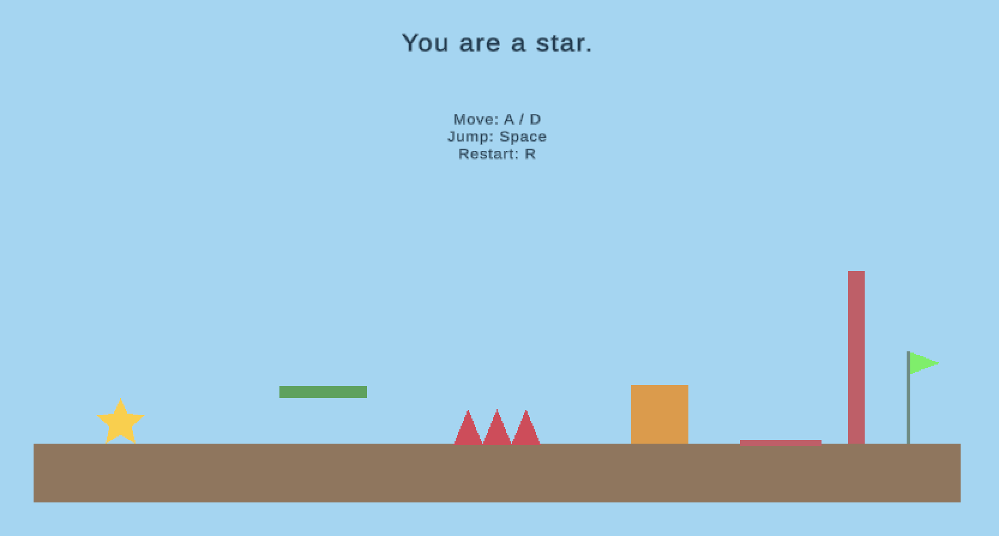

# StarFormer

StarFormer is a 2D puzzle-platformer built in Unity. Play as a star that possesses eligible objects on contact and uses their abilities to solve environmental puzzles. Grow or shrink as a box, rise through the air and swim underwater as a bubble, and leave bodies in useful positions while transferring control.

## Play the published build

- [Latest published build](https://xtraluck21.github.io/StarFormer/) — updated separately when a tested WebGL export is published.
- [Alpha Progress Check submission](https://xtraluck21.github.io/StarFormer/alpha-progress-check/) — frozen All-Level V2 submission.

The last recorded publication is **All-Level V2 (October 12, 2026)**, with Mainmenu, the old Tutorial, Level01 and Level02. It predates the new intros and E-key bubble exit. The introductory and Level 1 source updates through October 18 have no new WebGL publication recorded; merging source does not update either URL automatically.

All-Level V2 includes the fan-hint fix from source `d161538`, was exported to `Builds/WebGL-All-Level-V2`, and was published as `gh-pages` commit `8c48475`. Publishing commit `5a7f043` preserved it at `alpha-progress-check/`; the developer confirmed that URL worked. Keep that submitted folder unchanged. Future submissions need separate version folders, and the root can be updated with a newly tested release.

## Development references

- Unity editor: `6000.3.22f1`, with Web Build Support.
- Enabled build scenes: `Mainmenu` (0), `IntroBox` (1), `IntroBubble` (2), `Level01` (3), `Level02` (4). The old `Tutorial` remains in the repository but is excluded from builds.
- [Introductory levels](Docs/intro-levels.md) — October 17 polish: contextual movement/form hints, matching intro colors, current-scene restart buttons, a gated exit arrow, and short completion transitions into Level 1 and Level 2. Developer-reported Play Mode tests passed; merged into main via PR #11 (`989d2d1`); a new browser build remains pending.
- [Gameplay specification](Docs/GameplaySpec.md)
- [Script, scene and release reference](Docs/ScriptGuide.md)
- [Level 1 progress](Docs/level-1.md) — October 18 `level-1` handoff: ball checkpoints, U2 regeneration, visual/camera polish, Box-to-Bubble collision recovery and corrected ball prefab Form. Developer-reported testing passed; PR integration is pending and instruction polish is deferred.
- [Publish to GitHub Pages](Docs/publish_instructions.md)

