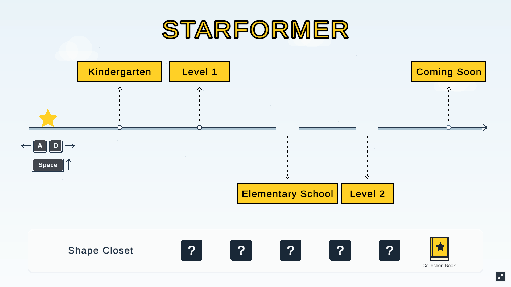

# StarFormer

**Latest release — Gold 0.1.0, published November 17, 2026.** [Play StarFormer](https://xtraluck21.github.io/StarFormer/)

StarFormer is a 2D puzzle-platformer built in Unity. Play as a star that possesses objects on contact and uses their abilities to solve puzzles. Grow or shrink as a Box, rise and swim as a Bubble, bounce as a Bouncy Ball, climb as a Spider and move obstacles with a Fan.



## Play

- [Gold](https://xtraluck21.github.io/StarFormer/gold/) — current release with desktop and touch controls.
- [Beta](https://xtraluck21.github.io/StarFormer/beta/)
- [Alpha](https://xtraluck21.github.io/StarFormer/alpha/)

Choose Kindergarten for the opening tutorials, Level 1 for the first puzzle level, Elementary School for the Spider and Fan tutorials, or Level 2 for the final challenges. Click or tap a destination sign, or move the star into an entrance.

## Controls

| Action | Desktop |
| --- | --- |
| Move | A/D. Gameplay scenes also accept left/right arrows. |
| Jump as Star | Space |
| Grow / shrink as Box | Hold J / K or left / right mouse button |
| Swim as Bubble | WASD underwater, A/D to steer while rising in air |
| Pop Bubble / leave Fan | Q or right mouse button |
| Toggle Fan wind | F or left mouse button |
| Pause / restart choices | Esc / R in gameplay scenes |

Bouncy Ball bounces automatically. Use A/D to steer it or move Spider along connected surfaces. Touching an eligible object triggers possession.

On mobile, drag the left joystick and use the right-hand buttons for the current form. Tap the house for pause, checkpoint, restart and main-menu options. The Collection Book explains each form as you discover it. Turn your phone sideways for a larger view.

On desktop, use the lower-right fullscreen button during windowed play. The first Esc exits fullscreen. [Full controls and gameplay details](Docs/GameplaySpec.md#2-controls)

## Development

Use Unity **6000.3.22f1** with Web Build Support. The enabled scenes follow this order.

```text
Navigation → IntroBox → IntroBubble → IntroBouncyBall → Level01 → IntroSpider → IntroFan → Level02
```

- [Gold release and local build instructions](Docs/Gold-0.1.0.md)
- [Publishing guide and release history](Docs/publish_instructions.md)
- [Gameplay specification](Docs/GameplaySpec.md) · [Script guide](Docs/ScriptGuide.md)
- [Tutorials](Docs/intro-levels.md) · [Level 1](Docs/level-1.md) · [Level 2](Docs/level-2.md)
- [Checkpoints](Docs/CheckpointGuidance.md) · [Analytics](Docs/AnalyticsAllLevels.md) · [Test plan](Docs/AnalyticsTestPlan.md)
