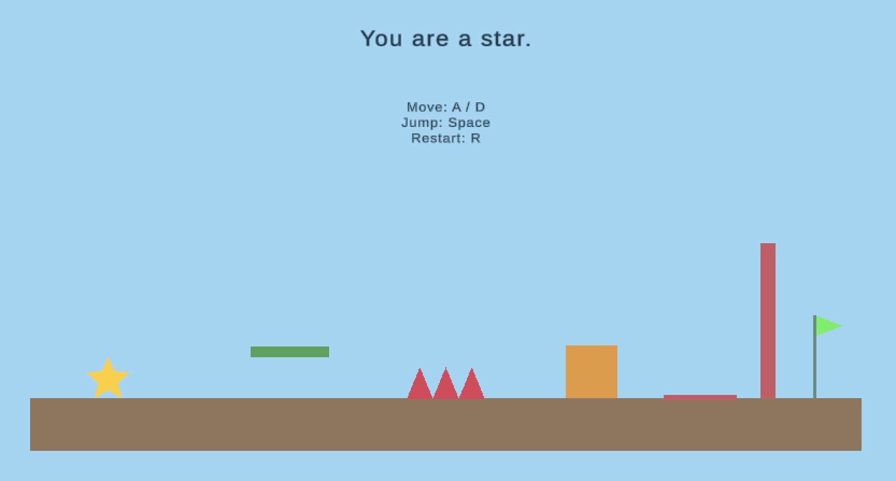

# StarFormer

StarFormer is a 2D puzzle-platformer built in Unity. Play as a star that possesses eligible objects on contact and uses their abilities to solve environmental puzzles. Grow or shrink as a Box, rise and swim as a Bubble, bounce and float as a Bouncy Ball, then learn Spider and Fan abilities.

## Published Beta 0.1.1

[Play StarFormer Beta 0.1.1](https://xtraluck21.github.io/StarFormer/beta/)

Beta 0.1.1 was published on November 3, 2026 at [the Beta URL](https://xtraluck21.github.io/StarFormer/beta/), from source `9451511` as `gh-pages` commit `e81097e`. Player Version and Analytics `buildVersion` are both `beta-0.1.1`. The release adds schema-v2 analytics for all seven gameplay scenes, refreshed analytics maps and the Level01 contextual movable-door hint. After 20 seconds without door movement, the optional star hint can be activated by deliberate player contact to preview lifting the door.

On November 5, all seven live Beta files returned HTTP 200 and matched `Builds/WebGL-Beta-0.1.1` and the publishing checkout byte for byte. This confirms the deployed package, not a new gameplay playtest or production analytics acceptance. Detailed browser/device gameplay, production event delivery and the refreshed backend map deployment remain separately unverified. See [the release record](Docs/publish_instructions.md#beta-011-release-status) and [acceptance follow-ups](Docs/AnalyticsTestPlan.md#beta-011-acceptance-status).

## Beta 0.1.2 preparation — current source

Player Version and Analytics buildVersion are now `beta-0.1.2`, prepared from main `5e7105c` on November 6. **This is source preparation, not a completed build or publication.** The last recorded deployed Beta remains 0.1.1; the current branch contains substantial later changes.

The next release includes interactive Navigation, school/level entrances, Collection Book integration, shared Home menus, the IntroFan rename, Level01 traversal/camera/possession fixes, and new Spider tutorial guidance. Shape Closet and Navigation’s Collection Book now share session-only per-form discovery: taking control of a form reveals its icon/help, scene changes and retries retain it, and a new game launch clears it. Completion no longer grants groups, and old persistent unlock saves are ignored. Obsolete Help components in IntroBox, IntroBubble and IntroSpider have been removed and their book/pause behavior checked in an isolated Editor run. Level02 Help work is deferred to its replacement scene.

All seven analytics maps are stale against the saved scenes and must be exported in Unity before building. See the [Beta 0.1.2 preparation and Unity checklist](Docs/Beta-0.1.2.md) for scope, concrete findings and uncompleted release steps. Preserve the recorded 0.1.1 export and historical evidence below.

## Historical Beta 0.1.0

Beta 0.1.0 was published November 2 from source `3a693ca` as `gh-pages` commit `1105970`, with developer-reported local/hosted playtests and Level01 production-event evidence. Its collector tracked only Level01/Level02. The dashboard Version 9 record documents historical map matching and aggregate metrics; this is separate from 0.1.1 runtime/data acceptance.

At the last recorded November 5 verification, `/beta/` served 0.1.1. The [root URL](https://xtraluck21.github.io/StarFormer/) served Beta 0.1.0 (root publication `f6eaf9e`), verified by its live page version on November 5. See [historical release evidence](Docs/AnalyticsTestPlan.md#beta-010-acceptance-status).

## Current gameplay and progression

```text
Navigation → IntroBox → IntroBubble → IntroBouncyBall → Level01 → IntroSpider → IntroFan → Level02
```

- IntroBox and IntroBubble teach contact possession, J/K resizing, air ascent, underwater steering and Q pop. Flag-opened passages support return travel between IntroBox/IntroBubble and IntroBubble/IntroBouncyBall without a Level up overlay between those scenes.
- IntroBouncyBall teaches automatic bouncing, floating on water, resuming bounces on land and faster bounces beneath low ceilings. The main route includes the low-ceiling lesson, short contextual headlines and a spike-death reminder. Its final flag transitions into Level01.
- Level01 was rebuilt with a new layout and form progression, replacing the original scene. It includes Star/Box route choices, a one-way lift, reversible SAFE/NORMAL/HARD choices, moving safe-route boards, a falling spike, three fixed-form checkpoints, contextual hints and Home pause/restart UI. The original map remains as disabled `Level01_Legacy`.
- Level01 continues through IntroSpider and IntroFan to Level02. Navigation maps Kindergarten to IntroBox, Level 1 to Level01, Elementary School to IntroSpider and Level 2 to Level02; tutorials remain optional.
- R opens restart choices; the shared house/Star Home menu is configured in all seven gameplay scenes and returns to Navigation. Collection Book and per-form Help are implemented in source; see the release checklist for verification coverage and deferred Level02 work.
- Level01 includes the upper-gap, checkpoint-2 approach, ball camera and Box-to-ball recovery fixes from PR #21. IntroSpider adds climbing arrows and cake/spike feedback. These changes are not in the recorded Beta 0.1.1 export.

## Published builds and history

- [Alpha 0.1.2](https://xtraluck21.github.io/StarFormer/alpha/) — historical release, October 18, 2026; does not contain the current rebuilt Level01 or integrated Bouncy Ball tutorial.
- [Earlier analytics playtest](https://xtraluck21.github.io/StarFormer/playtest-01/) — preserved older build.
- [Alpha Progress Check submission](https://xtraluck21.github.io/StarFormer/alpha-progress-check/) — frozen October 12 All-Level V2 submission.
- [Root Beta 0.1.0](https://xtraluck21.github.io/StarFormer/) — recorded at 0.1.0 on November 5; future Beta publishing must preserve this path.

Alpha 0.1.2 source configuration: `5650250`; gameplay/UI changes: `9b35f8e`; publishing commit: `5f62980`. Developer-reported localhost/online tests and deployed payload/version checks passed. Its embedded Player/Analytics version remains `alpha-0.1.2`; Sheet delivery for that version remains separately unconfirmed. Source updates do not change published exports.

## Development references

- Unity editor: `6000.3.22f1`, with Web Build Support.
- Enabled build scenes: Navigation (0), IntroBox (1), IntroBubble (2), IntroBouncyBall (3), Level01 (4), IntroSpider (5), IntroFan (6), Level02 (7). Mainmenu and legacy/reference/sandbox entries stay disabled.
- [Introductory levels](Docs/intro-levels.md) — tutorials, controls, contextual hints and two-way passages.
- [Gameplay specification](Docs/GameplaySpec.md)
- [Script, scene and release reference](Docs/ScriptGuide.md)
- [Level 1](Docs/level-1.md) — rebuilt map, route modes, lifts, checkpoints and Home menu.
- [Level 2](Docs/level-2.md) — integrated route, completion, hints and navigation.
- [Checkpoint guidance](Docs/CheckpointGuidance.md)
- [WebGL analytics implementation](Docs/AnalyticsImplementation.md)
- [WebGL analytics test plan](Docs/AnalyticsTestPlan.md)
- [Analytics dashboard](Docs/AnalyticsDashboard.md) — four aggregate metrics, verified real maps and Apps Script deployment.
- [All-level analytics and real maps](Docs/AnalyticsAllLevels.md) — all seven gameplay scenes, schema v2, map exports and validation.
- [Publish to GitHub Pages](Docs/publish_instructions.md)


